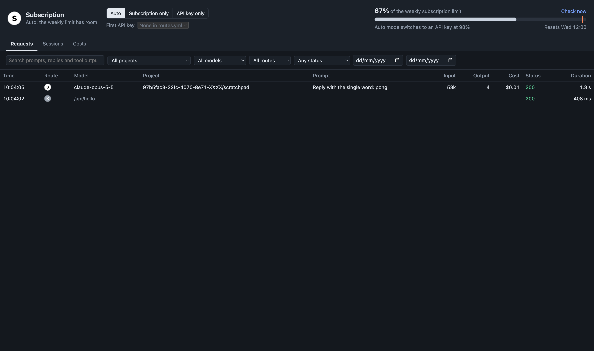

# claude-proxy

claude-proxy is a local proxy between Claude Code and the Anthropic API. It records every request in SQLite. When your weekly subscription limit is almost used, it sends Claude Code's subscription traffic to an API key. Claude Code does not see the change.



## How it works

1. Claude Code sends its traffic to `http://127.0.0.1:4100`, because `HTTPS_PROXY` points there. The proxy decrypts the connections to `api.anthropic.com` with a certificate from mkcert. It passes connections to other hosts through unchanged. Claude Code still sees `api.anthropic.com` as its API host, so Remote Control and its other first-party features stay on. With `ANTHROPIC_BASE_URL` set to the proxy, Claude Code turns off Remote Control.
2. The proxy reads the routing mode and the weekly subscription usage, and picks the first route:
   - **Auto**: the subscription, until weekly usage reaches 98%. After that, the API keys in `routes.yml`, with the subscription last.
   - **Subscription only**: the subscription.
   - **API key only**: the API keys in `routes.yml`.
3. On an API key route, the proxy replaces Claude Code's OAuth token with the route's API key.
4. The proxy moves to the next route in two cases only:
   - the subscription returns 429 for the weekly window;
   - an API key returns 401.

   Other errors, such as a 429 for the 5-hour window or a 529 overload, go back to Claude Code unchanged. When no route is left, Claude Code gets the last error.
5. Every subscription response reports weekly usage in its `anthropic-ratelimit-unified-7d-utilization` header. The proxy records this value.
6. While the weekly limit is reached, the proxy reads your usage from Anthropic every 5 minutes. In auto mode, traffic returns to the subscription when usage is below 98%, or when the weekly window resets.
7. The proxy stores each request and its response in `~/.claude-proxy/requests.sqlite`. Bodies are compressed with zstd. The database also stores the Claude Code session ID, the project directory, token counts and an estimated cost.

Requests that carry their own API key, and requests to paths other than `/v1/messages`, go to `api.anthropic.com` unchanged.

## Requirements

- macOS 13 or later
- Node.js 23.6 or later, for TypeScript type stripping and `node:sqlite`
- pnpm
- Xcode command line tools, for `swiftc`
- mkcert, with its local CA installed by `mkcert -install`

## Install

1. Install the dependencies:

   ```sh
   pnpm install
   ```

2. Build the web UI and the menu bar app:

   ```sh
   pnpm build
   ```

3. Install the launchd agents. They start the proxy and the menu bar app now and at each login:

   ```sh
   pnpm install_launchd_agents
   ```

4. Add your API keys to `~/.claude-proxy/routes.yml`. The first start of the proxy creates this file.

5. Create the certificate for `api.anthropic.com`:

   ```sh
   mkcert -cert-file ~/.claude-proxy/api.anthropic.com.pem -key-file ~/.claude-proxy/api.anthropic.com-key.pem api.anthropic.com
   ```

6. Point Claude Code at the proxy in your shell profile. Do not set `ANTHROPIC_BASE_URL`.

   ```sh
   export HTTPS_PROXY=http://127.0.0.1:4100
   export NO_PROXY=localhost,127.0.0.1
   export NODE_EXTRA_CA_CERTS="$(mkcert -CAROOT)/rootCA.pem"
   ```

   Claude Code passes these variables to the commands that it runs, so their HTTPS traffic also goes through the proxy tunnel.
   The proxy also accepts `ANTHROPIC_BASE_URL=http://127.0.0.1:4100`, but Claude Code then turns off Remote Control.

Run `pnpm install_launchd_agents` again after a Node.js upgrade, because the agent stores the path to `node`.

## Configuration

All configuration is in `~/.claude-proxy/`. The proxy reads each file again when the file changes.

| File | Contents |
| --- | --- |
| `routes.yml` | The API key routes, in failover order. Each route has `name`, `letter`, `colour`, `base_url` and `api_key`. |
| `pricing.yml` | Prices per million tokens for each model. The proxy uses them to estimate costs. |
| `api.anthropic.com.pem`, `api.anthropic.com-key.pem` | The mkcert certificate and key that the proxy uses to decrypt `api.anthropic.com` traffic. |
| `requests.sqlite` | The recorded requests, the routing mode, the selected API key and the last known weekly usage. |
| `local.claude-proxy.server.log` | The proxy log. |

Example `routes.yml`:

```yaml
api_key_routes:
  - name: anthropic-personal
    letter: P
    colour: "#3b82f6"
    base_url: https://api.anthropic.com
    api_key: sk-ant-api03-...
```

## Web UI

Open `http://127.0.0.1:4100/_proxy/`.

- The top panel shows the active route and the weekly usage. It also has the routing mode switch and the selector for the first API key.
- **Requests** lists every request. You can filter by project, model, route, status, date and session. The search box finds text in your prompts, Claude's replies, tool calls and tool output.
- **Sessions** lists Claude Code sessions by project, each with its first prompt and a `claude --resume` command.
- **Costs** shows estimated cost per day and route. Subscription rows show what the same requests would cost at API prices.

## Menu bar

The menu bar shows the active route: `S` on a white dot for the subscription, or the route's letter on its colour. A grey `!` means the proxy does not answer. The app reads the route once a minute.

## Commands

| Command | Action |
| --- | --- |
| `pnpm build` | Builds the web UI and the menu bar app. |
| `pnpm start` | Runs the proxy in the foreground. |
| `pnpm test` | Runs the proxy tests against fake upstream servers. |
| `pnpm typecheck` | Type-checks both packages. |
| `pnpm dev:server` | Runs the proxy and restarts it when a source file changes. |
| `pnpm dev:web_ui` | Runs the Vite dev server for the web UI, with `/_proxy/api` sent to port 4100. |
| `pnpm install_launchd_agents` | Installs and starts the launchd agents. |
| `pnpm uninstall_launchd_agents` | Stops and removes the launchd agents. Your data stays in `~/.claude-proxy`. |

## Project layout

```
packages/claude_proxy_server/   Node.js proxy, request database, routing and web API
packages/claude_proxy_web_ui/   React web UI, served by the proxy under /_proxy/
macos/claude_proxy_menu_bar/    SwiftUI menu bar app
launchd/                        Scripts that install and remove the launchd agents
```

## Security

The proxy listens on 127.0.0.1 only. It rejects requests whose Host is not `127.0.0.1` or `localhost`, and requests from web pages on other origins. The database stores request headers with the `Authorization` and `x-api-key` values replaced by `[redacted]`.

`api.anthropic.com-key.pem` lets any program that reads it impersonate `api.anthropic.com` to every program that trusts the mkcert CA. mkcert makes the file readable by your user only. The proxy decrypts only `api.anthropic.com`. It cannot read the traffic that it tunnels to other hosts.
