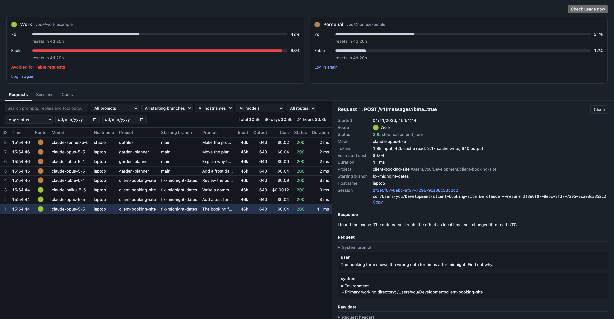

# claude-proxy

claude-proxy is a proxy between Claude Code and the Anthropic API. It runs on one machine, or as one central service for all your machines. It records Claude Code's Messages API requests in SQLite. It also sends each project's requests to the Claude subscription account that you chose for that project. When an account reaches a limit, the proxy moves the request to your other account. Claude Code does not see the change.



## How it works

1. Claude Code sends its traffic to `http://127.0.0.1:4100`, because `HTTPS_PROXY` points there. The proxy decrypts the connections to `api.anthropic.com` with a certificate that its own certificate authority signs. It passes connections to other hosts through unchanged. Claude Code still sees `api.anthropic.com` as its API host, so Remote Control and its other first-party features stay on. With `ANTHROPIC_BASE_URL` set to the proxy, Claude Code turns off Remote Control.
2. For a `/v1/messages` request, the proxy finds the project directory of the request. It picks the first entry of `project_routes` in `subscription_accounts.yml` whose pattern matches. Without a match, it picks `default_subscription_account`.
3. The proxy replaces Claude Code's OAuth token with its own access token for that subscription account. It changes nothing else in the request. The proxy gets its tokens from its own login to each account, described in [Log in to the subscription accounts](#log-in-to-the-subscription-accounts). It never reads, copies or refreshes Claude Code's own login.
4. The proxy moves the request to the next subscription account when an account rejects the request with a 429 for its 5-hour window or a weekly window. An account can also have its own `failover_utilization`. The proxy avoids an account at or above that fraction of its 5-hour or weekly window, before the account rejects anything. The example sets 0.98 on Work, so programs that use Work without the proxy, such as cron jobs on other servers, keep the last 2%. At that threshold, the project's own account stays in the plan as the last resort, after every other account.
5. A rejection for the 5-hour window or the weekly window blocks the account until the window resets. A rejection for the weekly window of one model, such as Fable, blocks only that model on that account. The proxy tries a blocked account last, after every account that is not blocked, because a blocked account can still have a little capacity. Other errors, such as a 401 or a 529 overload, return to Claude Code unchanged. When every account rejects the request, Claude Code gets the rejection of the project's own account.
6. Every response to a request that the proxy sends with its own access token reports the usage of its account in the `anthropic-ratelimit-unified-*` headers. The proxy records them. A response sent with Claude Code's own token does not update any account. The proxy also reads the usage of each account from Anthropic every 5 minutes.
7. The proxy stores each request and its response in `~/.claude-proxy/requests.sqlite`. Bodies are compressed with zstd. Each request repeats the whole conversation, so the proxy stores each message, the tools and the system prompt once, and each request keeps only references to them. The database also stores the Claude Code session ID, the project directory, token counts and an estimated cost. The project directory is the directory that Claude Code started in. A year after a request, the proxy deletes its headers, bodies and search text. Its tokens, cost, session and project stay, so the costs and the session list stay complete.

The proxy swaps the token on `/v1/messages*` only. Requests that carry their own API key, and requests to other paths, go to `api.anthropic.com` unchanged with Claude Code's own token. Remote Control, `/usage` and telemetry stay on the account that Claude Code is logged in to.

With a central claude-proxy, each machine runs the relay on `127.0.0.1:4100` in place of the proxy. The relay sends the `api.anthropic.com` connections to the central proxy, which does steps 2 to 7. When the central proxy fails, the relay connects Claude Code to `api.anthropic.com` directly. [Relay](#relay) gives the details.

## Requirements

- macOS 13 or later
- Node.js 23.6 or later, for TypeScript type stripping and `node:sqlite`
- pnpm
- Xcode command line tools, for `swiftc`
- OpenSSL, for `scripts/create_certificate_authority.sh`

## Install

These steps install the relay on a Mac. The relay connects Claude Code to a central claude-proxy. To run the proxy on the Mac itself, see [Run the proxy locally](#run-the-proxy-locally). On a Roy host, see [Roy host](#roy-host).

1. Install the dependencies:

   ```sh
   pnpm install
   ```

2. Build the menu bar app:

   ```sh
   pnpm build
   ```

3. Write the central proxy's URL to `~/.claude-proxy-relay/central_url` and your Gateway Auth token to `~/.claude-proxy-relay/gateway_auth_token`, and make both private. See [Relay](#relay) for the steps and for how to make a token.
4. Install the launchd agents. They start the relay and the menu bar app now and at each login:

   ```sh
   pnpm install_launchd_agents
   ```

   The script exits with status 1, and changes nothing, when `central_url` or `gateway_auth_token` is missing. Otherwise it removes the agent `local.claude-proxy.server` of an earlier version, so the relay can use port 4100. The relay log is `~/.claude-proxy-relay/local.claude-proxy.relay.log`.

5. Make the macOS keychain trust the central certificate authority, so that Claude Code trusts it. The relay downloads the file at its first start:

   ```sh
   sudo security add-trusted-cert -d -r trustRoot -k /Library/Keychains/System.keychain ~/.claude-proxy-relay/certificate_authority.pem
   ```

6. Point Claude Code at the relay with one of the methods in [Connecting Claude Code](#connecting-claude-code). Start Claude Code only after step 5, because the relay downloads the certificate authority at step 4 and the keychain trusts it only after step 5.

Run `pnpm install_launchd_agents` again after a Node.js upgrade, because the agents store the path to `node`.

Delete `~/.claude-proxy/routes.yml` after an upgrade from an earlier version. It holds API keys in plain text, and the proxy no longer reads it.

## Run the proxy locally

`pnpm install_launchd_agents` does not install the proxy as an agent. To run the proxy on one machine without a central proxy, follow these steps.

1. Stop the relay agent, because the proxy and the relay both use port 4100. Run `pnpm uninstall_launchd_agents`. It also removes the menu bar agent.
2. Run `pnpm build`, and then `pnpm start`. The first start creates `~/.claude-proxy/subscription_accounts.yml`. Edit it. See [Configuration](#configuration).
3. Create the certificate authority and the certificate for `api.anthropic.com`. The script refuses to replace an existing certificate authority:

   ```sh
   sh scripts/create_certificate_authority.sh ~/.claude-proxy
   ```

   Make the macOS keychain trust the certificate authority:

   ```sh
   sudo security add-trusted-cert -d -r trustRoot -k /Library/Keychains/System.keychain ~/.claude-proxy/certificate_authority.pem
   ```

4. Point Claude Code at the proxy with the local-proxy variants in [Connecting Claude Code](#connecting-claude-code).
5. Log in to each subscription account from the web UI. See [Log in to the subscription accounts](#log-in-to-the-subscription-accounts). Never log in to the same subscription accounts as the central proxy: when one server refreshes a login, the other server loses it.

## Connecting Claude Code

With the relay, Claude Code reaches the relay on `127.0.0.1:4100`, and uses `NODE_EXTRA_CA_CERTS="$HOME/.claude-proxy-relay/certificate_authority.pem"`. A local proxy uses `~/.claude-proxy/certificate_authority.pem`. The examples below show both.

Claude Code reaches the proxy in one of two ways:

- **As its HTTPS proxy.** `HTTPS_PROXY` sends every HTTPS connection to the proxy as a `CONNECT` tunnel. The proxy decrypts `api.anthropic.com` and passes other hosts through. Claude Code still sees `api.anthropic.com` as its API host, so Remote Control stays on.
- **As its API base URL.** `ANTHROPIC_BASE_URL` sends only API requests to the proxy, in plain HTTP. No certificate is needed. Claude Code turns off Remote Control for any base URL other than `api.anthropic.com`.

Claude Code passes its environment to the commands that it runs. With `HTTPS_PROXY`, their HTTPS traffic also goes through the proxy tunnel. While the proxy restarts, their connections fail.

| Method | What goes through the proxy | Remote Control | When the proxy is down |
| --- | --- | --- | --- |
| zsh function | Claude Code started from zsh, and the commands it runs | On | Claude Code connects directly |
| `env` in `~/.claude/settings.json` | Claude Code from every launcher, including IDEs, and the commands it runs | On | Claude Code fails until you remove the settings |
| `export` in the shell profile | Every program started from the shell, such as curl, git and npm | On | All HTTPS from the shell fails |
| `ANTHROPIC_BASE_URL` | Claude Code's API requests only | Off | Claude Code fails |

The zsh function is the recommended method. It changes nothing outside Claude Code, and it checks the proxy at each launch.

`NODE_EXTRA_CA_CERTS` lets Node.js programs that Claude Code runs trust the certificate authority. Claude Code itself trusts it through the macOS keychain, after the `security add-trusted-cert` command in [Install](#install). A running proxy also serves the certificate authority at `/_proxy/certificate_authority.pem`.

### zsh function

Add this function to `~/.zshrc`:

```zsh
#  Sends Claude Code through claude-proxy when the proxy answers on port 4100.
#  claude-proxy is the HTTPS_PROXY, so Claude Code keeps api.anthropic.com as
#  its API host, and Remote Control stays on.  When the relay's proxy_credential
#  file exists, the function uses the relay and sends the credential, with the
#  user name relay.  The check runs at each launch, so a stopped proxy never
#  leaves claude pointing at a dead address.  An HTTPS_PROXY or
#  ANTHROPIC_BASE_URL that is already set wins.
function claude() {
	local relay_proxy_credential_file="$HOME/.claude-proxy-relay/proxy_credential"
	local claude_proxy_address="127.0.0.1:4100"
	local claude_proxy_url="http://$claude_proxy_address"
	local certificate_authority_file="$HOME/.claude-proxy/certificate_authority.pem"
	local curl_configuration=""

	if [[ -r "$relay_proxy_credential_file" ]]; then
		local relay_proxy_credential="$(<"$relay_proxy_credential_file")"
		claude_proxy_address="127.0.0.1:${CLAUDE_PROXY_RELAY_PORT:-4100}"
		claude_proxy_url="http://relay:$relay_proxy_credential@$claude_proxy_address"
		certificate_authority_file="$HOME/.claude-proxy-relay/certificate_authority.pem"
		#  curl reads the credential from its standard input, because other users can see its arguments.
		curl_configuration="user = \"relay:$relay_proxy_credential\""
	fi

	if [[ -z "$HTTPS_PROXY$ANTHROPIC_BASE_URL" ]] &&
		print -r -- "$curl_configuration" |
			curl --config - --silent --fail --max-time 1 --output /dev/null "http://$claude_proxy_address/_proxy/relay-status"
	then
		HTTPS_PROXY="$claude_proxy_url" NO_PROXY="localhost,127.0.0.1" NODE_EXTRA_CA_CERTS="$certificate_authority_file" \
			command claude "$@"
	else
		command claude "$@"
	fi
}
```

### `env` in `~/.claude/settings.json`

Add these keys to the `env` object. Replace `/Users/you` with your home directory:

```json
{
  "env": {
    "HTTPS_PROXY": "http://127.0.0.1:4100",
    "NO_PROXY": "localhost,127.0.0.1",
    "NODE_EXTRA_CA_CERTS": "/Users/you/.claude-proxy/certificate_authority.pem"
  }
}
```

With the relay, use the credential URL and the relay's certificate authority. Replace `<credential>` with the contents of `~/.claude-proxy-relay/proxy_credential`. Then run `chmod 600 ~/.claude/settings.json`, because the file now holds the credential and is not private by default. On a host with several users, use the [zsh function](#zsh-function) in place of this method:

```json
{
  "env": {
    "HTTPS_PROXY": "http://relay:<credential>@127.0.0.1:4100",
    "NO_PROXY": "localhost,127.0.0.1",
    "NODE_EXTRA_CA_CERTS": "/Users/you/.claude-proxy-relay/certificate_authority.pem"
  }
}
```

### `export` in the shell profile

For a local proxy:

```sh
export HTTPS_PROXY=http://127.0.0.1:4100
export NO_PROXY=localhost,127.0.0.1
export NODE_EXTRA_CA_CERTS="$HOME/.claude-proxy/certificate_authority.pem"
```

For the relay, read the credential from its file:

```sh
export HTTPS_PROXY="http://relay:$(<~/.claude-proxy-relay/proxy_credential)@127.0.0.1:4100"
export NO_PROXY=localhost,127.0.0.1
export NODE_EXTRA_CA_CERTS="$HOME/.claude-proxy-relay/certificate_authority.pem"
```

### `ANTHROPIC_BASE_URL`

```sh
export ANTHROPIC_BASE_URL=http://127.0.0.1:4100
```

## Configuration

All configuration is in `~/.claude-proxy/`. A central service keeps it in `/data`, which `CLAUDE_PROXY_DIRECTORY` sets. The proxy reads each file again when the file changes. At start, the proxy makes the directory and `requests.sqlite` readable by you only. It does not start when another user owns them, because `requests.sqlite` holds the refresh tokens.

| File | Contents |
| --- | --- |
| `subscription_accounts.yml` | The subscription accounts with their failover utilization, and the project routes. It holds no credentials. |
| `pricing.yml` | Prices per million tokens for each model. The proxy uses them to estimate costs. |
| `certificate_authority.pem`, `certificate_authority-key.pem` | The certificate authority that `scripts/create_certificate_authority.sh` makes, and its key. |
| `api.anthropic.com.pem`, `api.anthropic.com-key.pem` | The certificate and key that the proxy uses to decrypt `api.anthropic.com` traffic. The certificate authority signs the certificate. |
| `requests.sqlite` | The recorded requests, the grants of the subscription accounts, their last known usage and their blocks. |
| `local.claude-proxy.server.log` | The log of a local proxy that runs as the earlier launchd agent. The relay log is `~/.claude-proxy-relay/local.claude-proxy.relay.log`. The central container logs to standard output: run `docker compose logs`. |

Example `subscription_accounts.yml`:

```yaml
subscription_accounts:
  - name: Work
    colour: "#a1c63d"
    failover_utilization: 0.98
  - name: Personal
    colour: "#ba8048"
project_routes:
  - project_path_pattern: /Users/example_user/Development/client*
    subscription_account: Work
  - project_path_pattern: /Users/example_user/Development/work-dev
    subscription_account: Work
default_subscription_account: Personal
```

| Key | Meaning |
| --- | --- |
| `subscription_accounts` | The accounts, in failover order. Each has a `name`, a `colour` and an optional `failover_utilization`. |
| `project_routes` | The first route whose `project_path_pattern` matches the project wins. The pattern is a glob and must be an absolute path. `~` is not expanded. A pattern also matches every subdirectory of a matching directory. |
| `failover_utilization` | A key of one account. It is a fraction above 0 and at most 1. The proxy avoids the account at or above this fraction of its 5-hour or weekly window. The default is 1, which means no threshold. A top-level `failover_utilization` is a validation error. |
| `default_subscription_account` | The account for a project that no route matches, and for a request with no project. Without this key, such a request tries the accounts in file order, with each blocked account last. |

The project is the directory that Claude Code started in. A request without that information uses the project of the earlier request in the same session.

The proxy reads `subscription_accounts.yml` again at each change, without a restart. After a parse or validation error, or when the file is missing, the proxy keeps the last valid configuration and shows the error in the web UI. When the file is broken at start, the proxy does no routing, and Claude Code uses its own token.

### Log in to the subscription accounts

The proxy needs its own login to each account. This login gives the proxy a grant that is separate from Claude Code's login. The proxy stores the grants in `requests.sqlite` and refreshes them itself. Use a different Claude account for each subscription account.

1. Open the web UI.
2. Press **Log in** on an account.
3. Log in to that Claude account in the browser. The browser then shows a code.
4. Copy the whole code. It has the form `<code>#<state>`.
5. Paste the code into the field under the account in the web UI, and press **Finish login**.

The login must finish within 10 minutes of step 2.

An account without a live grant sends Claude Code's own token unchanged. The web UI shows **Log in** again when the grant stops working.

## Web UI

Open `https://<public hostname>/_proxy/` on a central service, or `http://127.0.0.1:4100/_proxy/` on a local proxy. **Open web UI** in the menu bar opens the central service when `~/.claude-proxy-relay/central_url` exists.

- The top panel shows each subscription account with its name, email address and colour. It has a usage bar with the time to reset for the 5-hour window, the weekly window and each model window. It shows whether the proxy avoids the account or tries it last after a rejection, and until when. It has the **Log in** button, and it lists configuration errors.
- **Requests** lists every request. You can filter by project, model, route, status, date and session. The Route column shows the subscription account that served the request. A failover shows as two attempts. The search box finds text in your prompts, Claude's replies, tool calls and tool output. The filter bar shows the estimated cost of the matching requests: in total, in the last 30 days and in the last 24 hours. A grey project comes from an earlier request in the same session, because the request itself does not name its directory.
- **Sessions** lists Claude Code sessions by project, each with its first prompt and a `claude --resume` command. The Copy button copies the command, with a `cd` to the project directory.
- **Costs** shows estimated cost per day and subscription account. Subscription rows show what the same requests would cost at API prices.

## Menu bar

The menu bar shows one pie per subscription account, in file order. Each pie has the colour of its account and shows the usage of its weekly window. A pie turns red when the proxy tries the account last after a rejection for its 5-hour or weekly window, or avoids it at its `failover_utilization` of either window. A pie is full and red when a weekly window blocks the account. When every pie is red, every account has rejected requests or is at its threshold. A grey `!` means the proxy does not answer. The app reads the status once a minute. When `~/.claude-proxy-relay/proxy_credential` exists, the app sends that credential to the relay at each read.

## Run as a central service

A central claude-proxy serves every machine of one user. It runs as a Docker container on docker-host. The container listens on `0.0.0.0` and publishes port 4100. `deploy/README.md` gives the build, run and certificate authority steps.

| Setting | Meaning |
| --- | --- |
| `CLAUDE_PROXY_PUBLIC_HOSTNAME` | The public name of the service, here `claude-proxy.example.com`. The proxy accepts requests with that Host. |
| `CLAUDE_PROXY_LISTEN_ADDRESS` | The address that the proxy listens on. The default is `127.0.0.1`. The image sets `0.0.0.0`. |
| `CLAUDE_PROXY_GATEWAY_AUTH_VERIFY_URL` | The `/verify` URL of Gateway Auth with its `team_id`. See [Security](#security). |

A Moss proxy sends the public hostname to the container. Caddy in front of it calls Gateway Auth for each request: a browser logs in with a cookie, and the relay sends its token in `Authorization: Bearer`. Caddy cannot carry a `CONNECT` tunnel, so the relay sends an HTTP upgrade to `/_proxy/tunnel` in its place.

Open `https://<public hostname>/_proxy/` for the web UI. The subscription accounts, their grants and the recorded requests live in `/root/claude-proxy/data` on docker-host. Log in to the accounts from the web UI. See [Log in to the subscription accounts](#log-in-to-the-subscription-accounts).

### Cut over from a local proxy

Never run two servers with the same grants. A refresh revokes the previous access token of the grant, so two servers that refresh one grant log each other out. Keep the central container stopped from the first copy of the files until the local server is stopped. Follow these steps in order.

1. Deploy the central service with an empty data directory, as `deploy/README.md` describes. Make the certificate authority, and open `https://<public hostname>/_proxy/` through Gateway Auth. Then stop the container: `docker compose stop`.
2. Delete `requests.sqlite-wal` and `requests.sqlite-shm` from `/root/claude-proxy/data`, if they exist, because SQLite would apply the log of the empty database to the copied file and corrupt it. Stop and report if they exist after `docker compose stop`. Then copy `requests.sqlite`, `subscription_accounts.yml` and `pricing.yml` from `~/.claude-proxy` into that directory with rsync. The local proxy keeps running, and the container stays stopped.
3. Quit every Claude Code session on the machine that runs the local proxy. A running session keeps `HTTPS_PROXY=http://127.0.0.1:4100` and sends no credential. After the server stops it gets connection refused, and after the relay starts it gets 407. It never connects directly.
4. Stop the local proxy: `launchctl bootout gui/$(id -u)/local.claude-proxy.server`.
5. Run rsync again. It copies only the changes since step 2. Then run `chown 1000:1000` and `chmod 600` on the copied files, because the container runs as the user `node` and the server refuses files that another user owns.
6. Change each `project_path_pattern` to an absolute path in the copy of `subscription_accounts.yml` in `/root/claude-proxy/data`.
7. Start the container: `docker compose start`. It now holds the grants. Never start the local proxy again.
8. Install the relay on the machine, and check one Claude Code session in the web UI. A session that starts after the relay install uses the relay.
9. Install the relay on every other machine.
10. Delete `~/.claude-proxy/api.anthropic.com*.pem` on the machine that ran the local proxy, because the relay now uses the central certificate.

Between steps 4 and 8, a new Claude Code session started with the zsh function connects directly to Anthropic, and nothing records its requests. A session started with another method fails.

## Relay

The relay connects Claude Code on one machine to a central claude-proxy. It listens on `127.0.0.1:4100`, so stop the local proxy on that machine first. `pnpm install_launchd_agents` starts the relay at login on a Mac.

1. Make the relay directory, `~/.claude-proxy-relay`. `CLAUDE_PROXY_RELAY_DIRECTORY` changes it.
2. Write the central proxy's URL, such as `https://claude-proxy.example.com`, to `central_url` in that directory.
3. Make a token for this machine, and write it to `gateway_auth_token` in that directory. In your gateway-auth-repository checkout, run `pnpm --silent --filter gateway-auth tokens add gateway-auth-claude-proxy <machine name>`. The command prints the token once. `list` and `remove` manage the tokens.
4. Make both files private: `chmod 600 ~/.claude-proxy-relay/central_url ~/.claude-proxy-relay/gateway_auth_token`.
5. Start the relay with `pnpm start:relay`. `CLAUDE_PROXY_RELAY_PORT` changes the port. On a machine with several users, give each user's relay a different port.
6. Set `HTTPS_PROXY=http://relay:<credential>@127.0.0.1:4100` and `NODE_EXTRA_CA_CERTS=~/.claude-proxy-relay/certificate_authority.pem` for Claude Code. `<credential>` is the contents of `~/.claude-proxy-relay/proxy_credential`. The [zsh function](#zsh-function) does this for you.

At its first start, the relay writes 32 random bytes to `proxy_credential`, with mode 600. It never replaces the file. Every CONNECT needs the user name `relay` and that credential in `Proxy-Authorization`, or it gets 407. The status request needs them in `Authorization`, or it gets 401. Thus another user on the same machine cannot use your relay, your Gateway Auth token or your subscription accounts. `HTTPS_PROXY` holds the credential, so your own processes can see it. They can also read the file.

The relay does not start when a file is missing, or when the group or others can read `central_url`, `gateway_auth_token` or `proxy_credential`. It never logs the token or the credential.

At each start, the relay downloads the central certificate authority to `certificate_authority.pem`. It replaces the file only with a certificate. When the download fails, it keeps the existing file. While the file does not exist, the relay tries the download again every minute. Claude Code reads the file when it starts, so start Claude Code after the first download.

For each `CONNECT api.anthropic.com:443`, the relay opens a tunnel to the central proxy's `/_proxy/tunnel`, with your token in `Authorization: Bearer`. The central proxy decrypts and records the connection. Until `certificate_authority.pem` exists, the relay connects to `api.anthropic.com` directly, because Claude Code cannot trust the central proxy without it. The relay also connects directly when the central proxy gives no 101 to `claude-proxy-tunnel` within 5 seconds. Claude Code then uses its own login, and nothing records the requests. The relay logs one line for each fallback, at most once a minute. The relay connects every other CONNECT target from your machine.

The menu bar app reads `/_proxy/api/subscription-account-status` from the relay. The relay gets it from the central proxy, and answers 502 when the central proxy fails. The relay answers `/_proxy/relay-status` itself with 200 and `{"relay":"ok"}`, and makes no request to the central proxy. The zsh function uses this path as its launch check. Every other request gets 404. The relay accepts requests only from a loopback address, with the Host `127.0.0.1` or `localhost` on its port, and with the credential.

## Roy host

On a Roy host, the user's dotfiles clone this repository to `~/claude-proxy` and install `systemd/claude-proxy-relay.service` as a systemd user unit. The unit runs the relay with the `node` of mise, and restarts it after 5 seconds when it stops. Write `central_url` and `gateway_auth_token` to `~/.claude-proxy-relay` first. See [Relay](#relay). Then run:

```sh
systemctl --user enable --now claude-proxy-relay.service
```

On a host with several users, give each user a different port. Run `systemctl --user edit claude-proxy-relay.service` and add `Environment=CLAUDE_PROXY_RELAY_PORT=<port>` under `[Service]`. Set the same variable in the shell that runs the [zsh function](#zsh-function).

## Commands

| Command | Action |
| --- | --- |
| `pnpm build` | Builds the web UI and the menu bar app. |
| `pnpm start` | Runs the proxy in the foreground. |
| `pnpm start:relay` | Runs the relay in the foreground. |
| `pnpm test` | Runs the proxy and relay tests against fake upstream servers. |
| `pnpm typecheck` | Type-checks every package. |
| `pnpm dev:server` | Runs the proxy and restarts it when a source file changes. |
| `pnpm dev:web_ui` | Runs the Vite dev server for the web UI, with `/_proxy/api` sent to port 4100. |
| `pnpm install_launchd_agents` | Installs and starts the launchd agents of the relay and the menu bar app. |
| `pnpm uninstall_launchd_agents` | Stops and removes the launchd agents, including `local.claude-proxy.server` of an earlier version. Your data stays in `~/.claude-proxy` and `~/.claude-proxy-relay`. |

## Project layout

```
packages/claude_proxy_server/   Node.js proxy, request database, subscription account routing and web API
packages/claude_proxy_relay/    Node.js relay from a machine's Claude Code to a central proxy
packages/claude_proxy_web_ui/   React web UI, served by the proxy under /_proxy/
macos/claude_proxy_menu_bar/    SwiftUI menu bar app
launchd/                        Scripts that install and remove the launchd agents
systemd/                        systemd user unit of the relay, for Roy hosts
deploy/                         Compose file and instructions for the central service
Dockerfile                      The image of the central service
```

## Security

The proxy listens on 127.0.0.1 by default. `CLAUDE_PROXY_LISTEN_ADDRESS` changes the address. The proxy does not start on a non-loopback address unless `CLAUDE_PROXY_PUBLIC_HOSTNAME` is set. It rejects requests whose Host is not `127.0.0.1` or `localhost`, and requests from web pages on other origins. When `CLAUDE_PROXY_PUBLIC_HOSTNAME` is set, the proxy also accepts that Host without a port, with no Origin or the Origin `https://<public hostname>`, and it answers every CONNECT with 405. The database stores request headers with the `Authorization` and `x-api-key` values replaced by `[redacted]`. It stores the access and refresh tokens of the subscription accounts, so keep `~/.claude-proxy/requests.sqlite` private.

Other hosts and containers can reach the port of a central proxy without Caddy, so the proxy asks Gateway Auth itself. With `CLAUDE_PROXY_PUBLIC_HOSTNAME`, set `CLAUDE_PROXY_GATEWAY_AUTH_VERIFY_URL` to Gateway Auth's `/verify` URL with its `team_id`. Without it, the proxy does not start. For each request addressed to the public hostname, the proxy sends that URL only the request's `Authorization` header, when it holds a Bearer token, and its `Cookie` header. A 200 serves the request. Any other answer, or no answer within 5 seconds, gives 401. The proxy keeps each pass for 60 seconds, for one `Authorization` value or one `gate_session` cookie. A request addressed to the public hostname gets 404 for every path outside `/_proxy/`, so `/v1/` and `/api/` reach Anthropic only through the decrypted tunnel, and a gateway token never goes to Anthropic. A request addressed to `127.0.0.1` or `localhost` needs no Gateway Auth, so the proxy accepts it only from a loopback address, and gives 403 otherwise.

`certificate_authority.pem` has a name constraint: it can sign only `api.anthropic.com`. A program that reads `certificate_authority-key.pem` still cannot impersonate any other host. `api.anthropic.com-key.pem` lets any program that reads it impersonate `api.anthropic.com` to every program that trusts the certificate authority. The script makes both key files readable by your user only. The proxy decrypts only `api.anthropic.com`. It cannot read the traffic that it tunnels to other hosts.
